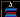
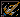
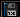
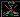

# Supremacy — screen inventory (GAM-63)

Every distinct UI view identifiable in `GAME.EXE`, what it shows, what the
player does there, and how it is reached — with the Rust port's status for
each. Addresses cite `decompiled/FUNCTIONS.md` / `docs/rust-port/*`; image
references are records in `decompiled/png/<SET>/`. The navigation-icon
pictograms extracted for this doc live in `screens/icons/` (native-res
crops of `MCG/000`).

The game's whole clickable UI is one mechanism: a list of `0x14`-byte
hotspot records (`[0x9194]` base, `[0x91A8]` count) polled every frame by
`menu::service` (`cs:0xA10F`). A "screen" is a hotspot list + a frame loop;
entering one installs its list, exits `jmp 0x2CC5` back to the shell.
`uimode` (`[0x91CD]`) identifies the current screen: 0 shell, 1 fleet,
2 detail, 3 orders, 4 build, 5 galaxy, 6 status, 7 surface.

## Boot / attract

### 1. Title attract — `cs:0x85B1`
Runs at boot and after every ending. Loads the `*IN` asset set and plays
the title slide (the "SUPREMACY — YOUR WILL BE DONE" art, `MCGIN/000`),
two extra MCGA-only slides (`[0x143] == 0x13`), a `0x7D`-frame retrace
wait, a `0x63`-frame starfield warm-up, then a repeating `menu_text`
credits crawl over the starfield. Any key or click jumps to the opponent
picker.
- **Icon:** none — runs at boot, not opened from a button.
- **Rust:** ported — `game/title.rs` + `title/{show,credits,pick}.rs`
  (`title_step` phase machine; `tests/game_title.rs`).

### 2. Opponent / scenario picker — `cs:0x87D7` (list `ds:0x9D36`, 2 records)
Shows one of four alien opponents — **WOTOK** (Baranross), **SMINE**
(Apte Tendril), **KRART** (Amphib), **RORN** — with species, galactic
dominance planet, "meanie" and physical-danger ratings, a threat/feature
description (`MCGIN/001`–`004`). Two buttons: **VIEW OPPONENT**
(`scenario_next` `0x8926`, cycles the four) and **CHALLENGE**
(`scenario_start` `0x8984`, picks the matching galaxy preset — planet
count/difficulty — and starts a new game via `0x305B`).
- **Icon:** none — its two buttons are text labels, not pictograms.
- **Rust:** ported — `game/title/pick.rs`, `preset.rs`.

### 3. Copy-protection prompt — `cs:0xEACD` (`protect_check`)
Once per run: prints "PAGE x, Nth PARAGRAPH Mth WORD" (one of ~24 shipped
manual lookups, file `0x1FDFB`–`0x201A6`) and runs the line editor for the
answer; a wrong word flashes an error and re-prompts. Typing `12`
auto-passes (built-in bypass). Reached through the intro/hotspot chain.
- **Icon:** none — text prompt only.
- **Rust:** **not ported** — no equivalent in `rust/src`.

## Main game screens

### 4. Shell (main screen) — uimode 0, `cs:0x2CC5` (list `ds:0xA0AC`, 49 records)
The home base the whole game idles in (backdrop image 0, `MCG/000`).
Shows: the large oval **planet viewscreen** (animated per selected
planet — `ppanel`; prints "CLASSIFIED!" for fallen worlds), a clickable
planet-grid minimap, the selected planet's name, the tick/day counter,
credits, and a scrolling **message ticker** along the bottom (events:
comets, treaties, pirate raids, research breakthroughs…).
Player can: select prev/next planet, select faction record, click the
minimap, click planet-list rows, open every other screen from the
toolbar row, launch a fleet, open the spy menu, open the save/load
dialog, toggle sound, request a status report (dumped to the ticker),
or pick one of 32 grid cells.
- **Reached by:** every other screen's right-button exit, new-game tail,
  load failure paths.
- **Icon:** none for the shell itself — it *hosts* the 10-icon toolbar
  the other screens are reached through (see
  [Screen-navigation icons](#screen-navigation-icons)).
- **Rust:** ported — `game/shell.rs`, `ppanel.rs`, `ticker.rs`,
  `hover.rs`, `selrec.rs`.

### 5. Galaxy screen  — uimode 5, `cs:0x395B` (sidebar list `ds:0xA81C`, 3 records)
The strategic starmap: system ovals + route overlay repainted by
`map_draw` (`[0x1278]`), with a blinking marker on the selected system.
A bottom bar (`Image(0x56)`, `MCG/086`: BUY, STARBASE/COST/CAPACITY/DATA)
carries the **machine-type selector** — view_prev/view_next cycle the
`ds:0x9B12` type table (`[0x91ED]` steps 0–6, index 1 skipped) — an
**info panel** reprints
the selected type's stats, and **gal_build** (`0x642E`) charges the
faction and constructs one (with a rename prompt). Ambient sfx vary by
selected type.
- **Reached by:** the galaxy button on the shell and the cross-screen
  rows of every other screen (`0x3906`/`0x3909`); right-button exits
  back to the shell.
- **Icon:**  — blue planet over
  stars, top row of the shell toolbar.
- **Rust:** ported — `game/frame.rs` (`Phase::Galaxy`),
  `screens/{galaxy,galbuild,galmsg}.rs`, `front/map.rs` **MCG only** —
  the EGA/CGA/TGA map painters are not ported (calls drop).

### 6. Planet detail screen  — uimode 2, `cs:0x2426`/`0x2429`/`0x247F`
(list `ds:0x9EDE`, 23 records)
Per-planet logistics (backdrop `MCG/041`): the selected ship's sheet
(CIVILIANS, TO CREW, CAPACITY, MAX FUEL, PAYLOAD, BAY) and the planet's
STORES columns (FOOD/MINERALS/FUEL/ENERGY). Player can: pick one of
three docking bays (`mach_sel`), transfer each resource and people
in/out of the docked ship (±5 steps, capacity-limited), drag the fuel
slider, "transfer all" / "unload all", and **scuttle** the ship
(Y-confirm; refunds credits + salvages fuel). Only colonised planets
(`kind 0xA`) open it — others get a ticker refusal.
- **Reached by:** detail button on the shell/cross-screen rows;
  `0x247F` is the windowed variant.
- **Icon:**  — domed capitol
  building, bottom row of the shell toolbar.
- **Machine detail** (`0x243D`, `screens/machd.rs`) is the same screen
  opened on a unit's host planet — "examine this machine".
- **Rust:** ported — `screens/detail.rs`, `screens/machd.rs`; several
  field-print routines still `Call::Native` stubs.

### 7. Status / docking-bay screen  — uimode 6, `cs:0x5867`/`0x587A`
(list `ds:0x9D60`, 19 records)
The planet's bays over a surface backdrop (`MCG/002`): docking-bay
rows plus six ship cells each with an ON/OFF toggle. Player can pick a
bay (`bay_pick 1–3`), load a ship into a free bay (`cell_load`), or
toggle ships' selected flag (`cell_sel`) — the working set other
screens launch/deploy from.
- **Reached by:** status button on shell/cross-screen rows; guarded —
  non-colonised records or unowned bays refuse with a ticker message.
- **Icon:**  — dark planet ringed
  by an orbit band, bottom row of the shell toolbar.
- **Rust:** ported — `screens/status.rs`.

### 8. Orders screen  — uimode 3, `cs:0x31F2`/`0x31F5`
(list `ds:0xA85A`, 42 records)
The colony ledger (backdrop `MCG/064`): a scrollable list of planets
with NAME/DATE/STATUS, FOOD/MINERALS/FUELS/ENERGY stocks, POPULATION,
POP.GROWTH, TAX RATE, and MILITARY STRENGTH. Player can: page through
the list, select a row (opens that planet on the surface screen),
rename a colony, jump a planet into the build screen, **collect**
taxes from all colonies (`order_collect` — lumps every colony's credit
income into the faction account), and switch between three display
modes (`order_mode 0/1/2`).
- **Reached by:** orders button on shell/cross-screen rows.
- **Icon:**  — bar/line chart on
  axes, top-left cell of the shell toolbar.
- **Rust:** ported — `screens/orders.rs`, `screens/open.rs`.

### 9. Build screen  — uimode 4, `cs:0x4BA7`/`0x4BAA`
(list `ds:0xA482`, 46 records)
Ship/machine outfitting at a planet (backdrop `MCG/042`): two side-by-side
SHIP panels (SHIP/DATE/CLASS, CREW/FUEL/CLASS), RENAME, and a HEADING
block (SHIP/FROM/TO/ETA/FUEL). Player can: pick a bay (`bmach_sel`),
load a unit aboard (`build_xfer`), **launch** a ship — a modal
destination pick on the starmap — deploy a landed unit onto the planet
(`build_deploy`), view a unit spec sheet (`build_stats`), rename a unit
(auto-serial-bumped "UNIT 07"→"UNIT 08"), or open a machine's host
(`mach_open`).
- **Reached by:** build button on shell/cross-screen rows, or
  `order_build` from the orders screen.
- **Icon:**  — rocket streaking
  right over sparks, top row of the shell toolbar.
- **Rust:** ported — `screens/build.rs`.

### 10. Fleet screen  — uimode 1, `cs:0x5F12`/`0x5F15`
(list `ds:0xAEEE`, 11 records)
The shipyard market (backdrop `MCG/039`): two scrollable listing
columns with page/column buttons and field selectors (`fld8`/`fldA`
step the compared fields), funding/cost readouts on the right. Player
can **buy** a vessel (price checked against faction credits) and
**scrap** an owned unit for a refund.
- **Reached by:** fleet button on shell/cross-screen rows.
- **Icon:**  — orange dock
  crane/claw, top row of the shell toolbar.
- **Rust:** ported — `screens/fleet.rs`; the HUD banner prints
  (`0x6075`/`0x60B6`/`0x60D4`) are still `Call::Native` stubs.

### 11. Surface screen  — uimode 7, `cs:0x4036`
(list `ds:0xABA4`, 42 records)
The planet-surface layout (backdrop `MCG/087`): a large grid of surface
cells beside SHIP/docking-bay slots and an "AGGRESSION" panel. Player
can: assign machines to surface slots (`surf_assign`), pick bay slots
(`surf_slot`), step the defence-system level 0–3 (`surf_mode`, icon
redraws), set production quantity (`surf_qty` +/−, `surf_max`), and open
a surface info panel (`surf_panel`). Guarded: refuses uncolonised /
machine-less records with a ticker message.
- **Reached by:** the surface button on the shell (`0x4036`), or
  `order_sel` opening a kind-`0xA` row from orders.
- **Icon:**  — skull &
  crossbones, bottom row of the shell toolbar. The screen also owns
  the three defence/aggression-level icons (`MCG/088`–`090`,
  redrawn by `surf_mode`).
- **Rust:** ported — `screens/surface.rs`.

## Modal dialogs (swap the hotspot list)

### 12. Save/load dialog  — `cs:0x2E21` (list `ds:0xB05C`, 3 records)
Popup frame `MCG/299` with three buttons: **NEW GAME** (restart the
scenario from the `0x8432` checkpoint snapshot, behind the confirm
dialog), **LOAD** and **SAVE** — both run the filename line editor.
A successful load restores the recorded `[0x91E5]` scenario banner
(`Loaded::{A,B,C,D}` → "WOTOK"/"SMINE"/"KRART"/"RORN ").
- **Reached by:** the disk icon on the shell. Right-button closes.
- **Icon:**  — floppy disk, last cell
  of the shell toolbar.
- **Rust:** ported — `dialog.rs`, `dlg_io.rs`, `save.rs`.

### 13. Restart-confirm dialog — (list `ds:0xB09A`, 2 records)
"Start over?" — `0x8427` restart / `0x2F95` cancel.
- **Icon:** none — opened from the save/load dialog's NEW GAME button.
- **Rust:** ported — `dialog.rs`, `screens/misc.rs` (`restart`).

### 14. Yes/no dialog — `cs:0x2F9B` (list `ds:0xB0C4`, 2 records)
Generic two-button confirm; events use it for offers like the Scorpian
V4's "WOULD YOU LIKE TO COMPLY? * YES / NO *". The answer returns
through cell `[0x91DA]` (1 yes / 2 no / `0xFF` cancel).
- **Icon:** none — generic two-button confirm, text only.
- **Rust:** ported — `dialog.rs` (`confirm`), `dlg_io.rs`
  (`act_yes`/`act_no`/`act_cancel`).

### 15. Tribute modal — event-VM `dialog` op `cs:0x79C3` (list `ds:0xB032`, 2 records)
The scripted encounter's payment modal (the Scorpian V4 demanding
"900 T. OF FUEL AND 390 T. OF FOOD"): **vm_max** (`0x7A11`/`levy`)
fills the payment up to the demanded amount the player can afford,
**vm_ok** (`0x7A45`) commits — refusal/outcome continues the event
script (e.g. troops slaughtered, goods teleported away).
- **Reached by:** the event VM — no user navigation.
- **Icon:** none — raised by the event script, not a toolbar button.
- **Rust:** ported — `vplan::levy`, `vimpl` `dialog` op, `vdir::disaster`.

### 16. Spy-mission picker  — `cs:0x8149` (list `ds:0xAFCC`, 5 records)
Shell "spy" button on a selected planet: refuses own/dead/en-route
targets with a message ("CANNOT SPY ON YOUR OWN STARS!", "NO SPYS ON
THIS DEAD STAR!"), else a modal list of four mission types plus
cancel (`[0x91DC]` = 1–5). Missions cost escalating credits
("SPY INFORMATION COSTS:", 1000–4720) and enqueue "SPY INFORMATION
FOR:" reports staging the target's stocks/fuel to the ticker.
- **Icon:**  — satellite dish, bottom
  row of the shell toolbar (opens this picker).
- **Rust:** ported — `screens/spy.rs`.

### 17. Line editor — `cs:0xE66E` (`line_input`) + `cs:0xE652`/`0xE77D`/`0xE7CD`
The blocking text field used wherever the game wants a name: save/load
filenames, planet renames, unit naming (with the serial-number
auto-bump). The world pauses while it runs (`LINE_MODE` gates
`tick_step`). Keys: make = append, backspace, pad-key accepts, right
click = accept.
- **Icon:** none — inline text field overlaid on the current screen.
- **Rust:** ported — `linein.rs`, `namedit.rs`.

## Endings

### 18. Defeat sequence — `cs:0x8B17` (`*DTH` asset set)
Fired by the `0xFA` endgame monitor when the player's faction record
reads kind `7` (fallen/conquered), or a `0x37C7` scan finds no kind-`7`
records left — the "lost last world" condition: loads
`*DTH.BIN`/`*DTH.GPH`, swaps to the defeat song, and plays a
full-screen cinematic — the alien emperor looming (`MCGDTH/000`) —
with scenario-keyed `menu_text` pages over a starfield, then waits for
input and restarts via `0x1D35` → title.
- **Icon:** none — fired by the `0xFA` endgame monitor.
- **Rust:** ported — `vend.rs` + `vend/{seq,tail,fx}.rs`
  (`Vm::end` phase; `tests/game_end.rs`).

### 19. Victory sequence — `cs:0x8C65` (`*WIN` asset set)
Fired when record `0` (the home/starbase record) reads kind `0xA`
(inhabited), or when the `0x37C7` scan finds no kind-`0xA` worlds
remaining. Same structure: `*WIN` assets, victory song, the
throne-room ceremony art (`MCGWIN/000`), credits `menu_text` pages —
with a scenario-specific final page + image on the RORN preset —
input wait → restart tail.
- **Icon:** none — fired by the `0xFA` endgame monitor.
- **Rust:** ported — same `vend` module.

### Transient: "insert disk 2" prompt — `cs:0x8AC0`
Retry prompt inside the asset loaders ("PLEASE INSERT 'SUPREMACY'
DISK 2…PRESS THE SPACE BAR") from the original two-disk release —
fires on a failed file open, e.g. before an ending set is present.
- **Icon:** none — DOS-era retry prompt, text only.
- **Rust:** not modelled — a missing pair counts as `dropped`
  (`front/load.rs`).

## Things that are UI, not screens

- **Message ticker** — the scrolling status line on the shell; carries
  all event narration (comets, treaties, spy reports, disasters).
- **Status report** (`0x2D97`) — a shell action that dumps the selected
  planet's stats as ticker text, not a view of its own.
- **Fleet launch** (`cs:0x71E3`) — a shell action, not a screen: scans
  `0x9491` for a free kind-4 fleet slot to send the selected ships.
  Toolbar pictogram  —
  launch pad, top row of the shell toolbar.
- **Minimap** — a 32-cell planet grid painted inside the shell backdrop;
  `cell_pick`/`map_click` hotspots select records through it.
- **Hover popup** (`map_gate` `cs:0x8DC6`) — the oval hover test on the
  shell viewscreen that repaints the map outside the planet ellipse.

## Screen-navigation icons

Ten pictograms are baked into the shell backdrop (`MCG/000`) as the
toolbar — hotspot records 5–14 of the shell list (a 2×5 block at
screen (26,155)–(133,190)). The icon graphics are part of the backdrop
art, not standalone image records: each cell's `0x14`-byte hotspot
carries only its rect + action (`+8` image field is `0`). Extracted at
native 20×17 to `screens/icons/`:

| | | | | |
|---|---|---|---|---|
|  orders |  galaxy |  build |  fleet launch |  fleet |
|  detail |  status |  surface |  spy |  save/load |

- Top row (left→right): **orders** (chart on axes), **galaxy**
  (blue planet over stars), **build** (rocket over sparks),
  **fleet launch** (launch pad — an *action*, not a screen:
  `cs:0x71E3` scans `0x9491` for a free kind-4 fleet slot), **fleet**
  (dock crane/claw).
- Bottom row: **detail** (domed capitol), **status** (planet ringed
  by an orbit band), **surface** (skull & crossbones), **spy**
  (satellite dish → spy-mission picker), **save/load** (floppy →
  save/load dialog).

The same pictograms recur — re-rendered on each screen's own backdrop —
wherever a cross-screen icon strip exists (rects from the shipped
hotspot templates, file `ds + 0x10CA0`):

| Screen | Strip position (screen coords) | Destinations |
|---|---|---|
| shell | 2×5 block (26,155)–(133,190) | orders, galaxy, build, *fleet launch*, fleet / detail, status, surface, spy, save |
| status | row (223,176)–(311,192) | galaxy, orders, build, detail |
| detail | row (6,174)–(113,192) | build, status, orders, galaxy, fleet |
| build | columns (6,128)–(25,191) and (292,128)–(311,191) | mach-open, galaxy, mach-detail / status, orders, fleet |
| orders | column (6,128)–(25,191) | surface (via `order_sel`), build (via `order_build`), detail |
| fleet | single icon (4,178)–(23,194) | surface (via `order_sel`) |
| surface | row (208,178)–(311,194) | fleet, build, orders, detail, status |
| galaxy, picker, modals, endings | none | — |

## Rust-port status summary

Ported and exercised in `rust/` (entries, hotspot lists, frame loops,
selection logic, dialogs, title + both endings): every screen above
except the copy-protection prompt and the disk-2 prompt. Caveats:

- Screen-specific print/draw helpers inside several screens still emit
  `Call::Native` → counted `dropped` by `front::Host` — screens show
  chrome/backdrop and take input, but some dynamic fields don't paint
  yet (tracked by the `dropped` counter; see `docs/rust-port/front.md`).
- Non-MCG video-mode painters (the EGA/CGA/TGA `map_draw` twins, EGA
  starfield) are unported — the port is feature-complete on MCGA and
  structurally complete, minus those painters, on the other modes.
